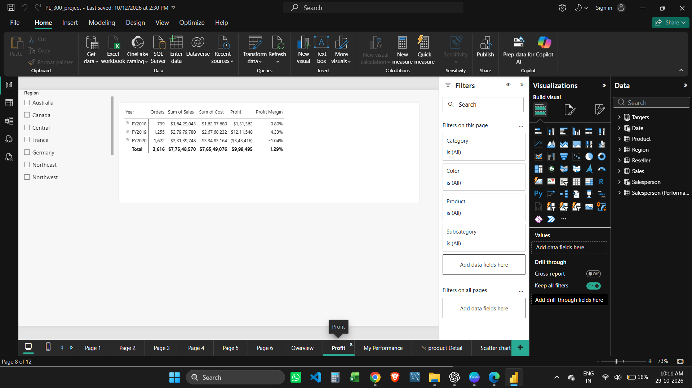
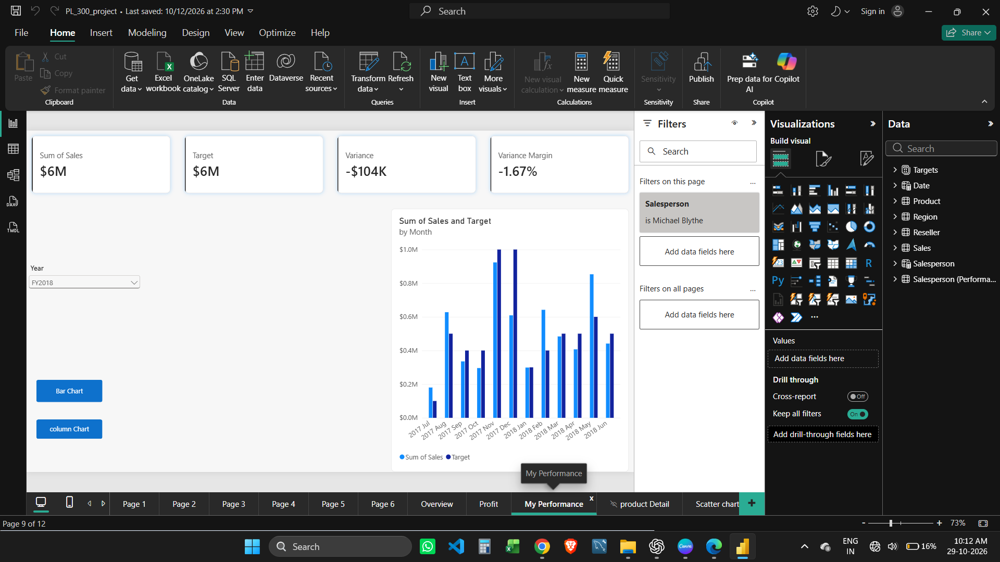
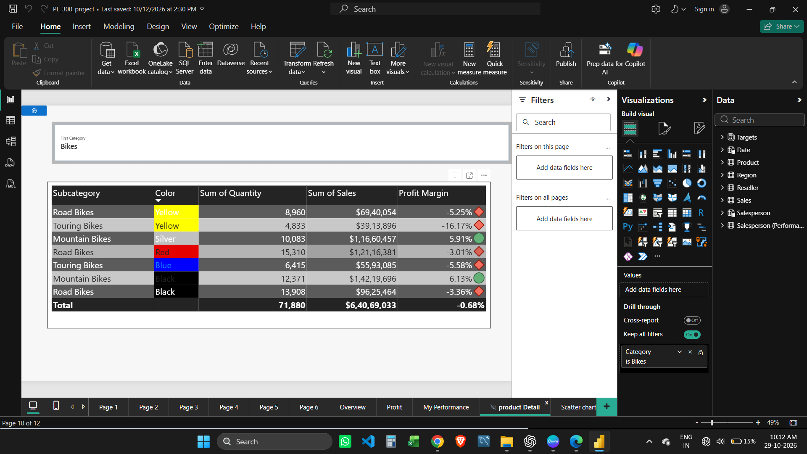
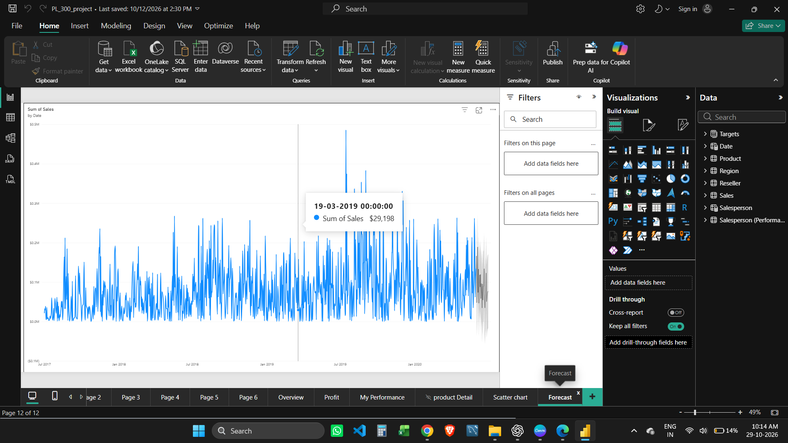

# PL-300 Guided Power BI Sales Report

A course-guided Power BI practice project using the Adventure Works sample report. I followed the PL-300 course lessons and referred to a GitHub example while learning how to explore the data, build report pages, and use interactive Power BI features.

> This is a learning project completed with guidance. The report is shared to demonstrate the Power BI concepts I practiced, not as independent client or production work.

## Report walkthrough

The PBIX contains 12 report pages. The first six currently appear as Page 1 through Page 6 in the report tabs; the descriptions below explain what each page explores.

1. **Sales by Category and Salesperson** - compares category sales, profit, profit margin, salesperson sales, targets, and variances in tables.
2. **Sales Trends and KPIs** - reviews time-based sales measures, including average, median, minimum, and maximum price, orders, order lines, sales, and year-to-date sales.
3. **Regional Sales Breakdown** - explores sales by region, country, and group, including each area's share of sales.
4. **Year-over-Year Sales Comparison** - compares yearly results and practices a previous-period comparison.
5. **Sales by Year and Category** - uses a year and category matrix to compare sales and related measures across periods.
6. **Quarterly Sales and Running Total** - visualizes quarterly sales alongside a running total.
7. **Overview** - brings together sales trends, category comparisons, and region filters.
8. **Profit** - summarizes orders, sales, costs, profit, and profit margin by year.
9. **My Performance** - compares sales and targets, with variance indicators and chart switching buttons.
10. **Product Detail** - filters product-level results and displays quantity, sales, and profit margin.
11. **Scatter Chart** - provides a scatter-chart view for exploring relationships in the sales data.
12. **Forecast** - shows a time-series sales forecast with historical and projected values.

## What I practiced with course guidance

- Navigating a multi-page report and organizing views for different questions.
- Comparing sales performance by time, category, region, country, product, and salesperson.
- Reading measures such as sales, profit, profit margin, targets, variance, year-to-date sales, and running totals.
- Using tables, matrix visuals, cards, bar and column charts, line charts, scatter charts, slicers, and filters.
- Adding interactive report navigation and switching between chart views.
- Exploring a forecast visual and distinguishing projected values from historical sales.

The descriptions above summarize the learning activities shown in the report. They do not imply that every calculation, data model, or visual was created independently.

## Screenshots

### Overview

### Profit analysis

### Product detail

### Forecast

## Files

- `Lab_07_done.pbix` - Power BI report file.
- `README.md` - project overview and learning notes.
- `forecast,overview,product-Detail,profit` - screenshots embedded in this README.

## Guidance and attribution

This project was completed as guided PL-300 course practice with a GitHub reference used for learning. Please follow the course terms, the original repository's license, and any dataset terms when sharing or reusing materials. Add the instructor/course and source repository links here if you have them.
